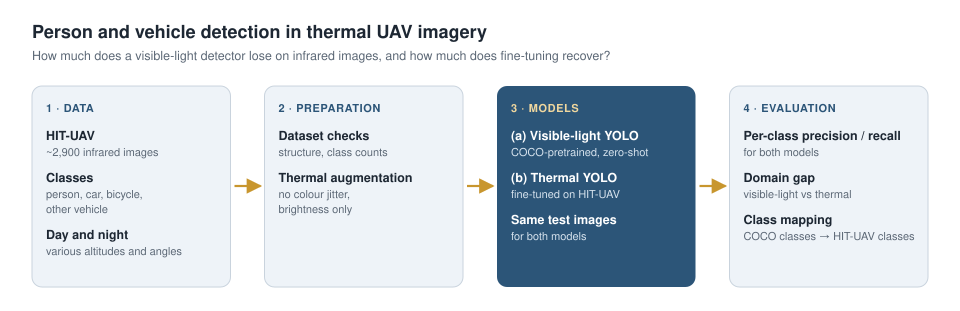
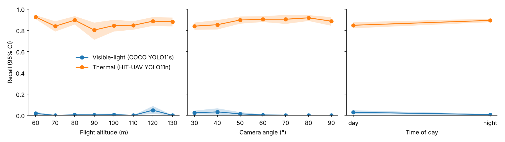

# Person and Vehicle Detection in Thermal UAV Imagery

[](https://github.com/mahdildarr/thermal-detection-hituav/actions/workflows/ci.yml)

**Night-time and low-visibility detection of people and vehicles** in infrared images captured by UAV thermal cameras, and **analysis of the performance gap** between the visible-light and thermal domains.

<p align="center"></p>

## Problem

At night and in low-visibility conditions, UAVs rely on thermal cameras. However, most detection models are trained on visible-light images (e.g. COCO). Thermal images carry no color or texture information; objects appear through temperature differences. As a result, models trained on visible light suffer a large performance drop on thermal imagery.

## Approach

| Step | Method | Module |
|---|---|---|
| 1. Data preparation | Accept the Kaggle release or the official GitHub release; per-split statistics of classes, day / night, altitude and camera angle; training YAML | `thermaldet.prepare_data` |
| 2. Capture metadata | Every HIT-UAV file name encodes time of day, flight altitude (60–130 m) and camera angle (30–90°); these are parsed for the error analysis | `thermaldet.hituav` |
| 3. Baseline | A COCO-pretrained model evaluated directly (zero-shot) on thermal data, with COCO classes mapped to HIT-UAV | `thermaldet.compare_domains` |
| 4. Domain adaptation | Fine-tune the same model on HIT-UAV from a YAML config; hue / saturation augmentation off (single-channel intensity), brightness on, vertical flips on (nadir views); model selection on val, the test split is touched once | `thermaldet.train` |
| 5. Comparison | Per-class precision / recall, COCO AP and per-class AP50 of both models on the same test images; DontCare boxes are ignored regions, not false positives | `thermaldet.compare_domains` |
| 6. Error analysis | Recall by time of day, altitude, camera angle and object size, with 95% bootstrap intervals over images | `thermaldet.compare_domains` |

## Data

- **HIT-UAV** (Suo et al., *Scientific Data*, 2023): 2,898 infrared thermal images (640 × 512) captured from UAVs at 60–130 m altitude and 30–90° camera angle, 32% by day and 68% by night. Classes: Person, Car, Bicycle, OtherVehicle, DontCare. Official split: 2,029 train / 290 val / 579 test images.
- Download: [Kaggle](https://www.kaggle.com/datasets/pandrii000/hituav-a-highaltitude-infrared-thermal-dataset) or the [official repository](https://github.com/suojiashun/HIT-UAV-Infrared-Thermal-Dataset) (`git clone` is enough; both layouts are supported).

## Installation

```bash
git clone https://github.com/mahdildarr/thermal-detection-hituav.git
cd thermal-detection-hituav
pip install -e ".[dev]"
pytest -q          # unit tests + end-to-end run on synthetic data (no GPU or weights needed)
```

The quickest way to run everything is the `notebooks/colab_thermal_detection.ipynb` notebook on Google Colab (GPU enabled).

## Usage

```bash
# 1) Data preparation (Kaggle download or a clone of the official repository)
python -m thermaldet.prepare_data --root <downloaded folder> --out data/hituav.yaml

# 2) Thermal fine-tuning (YOLO11s on a GPU; configs/hituav_yolo11n.yaml is small enough for a CPU)
python -m thermaldet.train --config configs/hituav_yolo11s.yaml

# 3) Visible-light vs thermal comparison and error analysis by capture condition
python -m thermaldet.compare_domains --data data/hituav.yaml \
    --model "Visible (COCO)=yolo11s.pt" --model "Thermal (HIT-UAV)=runs/thermal/yolo11s_thermal/weights/best.pt"
```

## Evaluation metrics

- **Both models:** precision / recall per class at a fixed confidence threshold (0.25, IoU ≥ 0.5); COCO AP, AP50, AP_small / AP_medium and per-class AP50 (pycocotools, DontCare as crowd regions)
- **Error analysis:** recall by time of day, flight altitude, camera angle and object size, with 95% bootstrap intervals that resample images (objects in one image are correlated)

## Results: HIT-UAV test split

579 test images (4,780 objects). The visible-light model is COCO-pretrained YOLO11s, used zero-shot with mapped classes. The thermal model is the smaller YOLO11n, fine-tuned for 15 epochs on the 2,029 training images on a CPU (`configs/hituav_yolo11n.yaml`), with the checkpoint selected on val.

| Model | Precision | Recall | AP50 | AP | AP50 Person | AP50 Car | AP50 Bicycle | AP50 OtherVehicle |
|---|---|---|---|---|---|---|---|---|
| Visible-light, zero-shot (YOLO11s) | 0.682 | 0.012 | 0.054 | 0.026 | 0.082 | 0.133 | 0.000 | 0.000 |
| Thermal, fine-tuned (YOLO11n) | 0.748 | 0.882 | 0.753 | 0.456 | 0.878 | 0.933 | 0.844 | 0.357 |

Precision / recall at confidence 0.25, IoU ≥ 0.5; DontCare regions ignored.

**The domain gap is close to total.** The COCO model finds 1.2% of the people and vehicles in thermal images, and what it does report is mostly right (precision 0.68): it is not confused, it simply does not recognise warm blobs as objects. A model a quarter of the size, trained for 15 epochs on 2,000 thermal images, reaches AP50 0.75.

<p align="center"></p>

Error analysis of the thermal model (recall with 95% bootstrap intervals over images):

| Condition | Recall |
|---|---|
| Night / day | 0.893 [0.877, 0.909] / 0.848 [0.819, 0.876] |
| Camera angle 30–40° (oblique) / 60–80° | 0.84–0.85 / 0.90–0.92 |
| Altitude 60 m / 90 m | 0.925 [0.906, 0.942] / 0.802 [0.711, 0.872] |
| Small / medium / large objects | 0.851 / 0.955 / 1.000 |

- **Night is easier than day.** At night the ground cools and people and running engines stand out; by day, sun-heated surfaces reduce the thermal contrast. The difference is small but the intervals barely touch.
- **Oblique views are harder than near-nadir ones**, likely because of occlusion and a larger range of object scales within one image.
- **Altitude has no clean trend** beyond 60 m: the dataset mixes altitude with scene and angle, so these per-altitude differences should not be read as a causal effect of height.
- **OtherVehicle is the weak class** (AP50 0.36): it has only 102 training and 34 test instances.

Reproduce (CPU; about 2.5 h for training):

```bash
git clone --depth 1 https://github.com/suojiashun/HIT-UAV-Infrared-Thermal-Dataset hit-uav
python -m thermaldet.prepare_data --root hit-uav --out data/hituav.yaml
python -m thermaldet.train --config configs/hituav_yolo11n.yaml
python -m thermaldet.compare_domains --data data/hituav.yaml \
    --model "Visible (COCO YOLO11s)=yolo11s.pt" --model "Thermal (YOLO11n)=runs/thermal/yolo11n_thermal/weights/best.pt"
```

## Progress

- [x] HIT-UAV dataset checks and training configuration (Kaggle and official layouts)
- [x] Thermal fine-tuning with brightness-only augmentation
- [x] COCO to HIT-UAV class mapping for the visible-light baseline
- [x] Per-class visible-light vs thermal comparison with COCO AP; DontCare as ignored regions
- [x] Error analysis by altitude, viewing angle, time of day and object size, with bootstrap intervals
- [x] Zero-shot baseline and YOLO11n thermal fine-tuning on the HIT-UAV test split
- [x] Package, unit tests, end-to-end test on synthetic data, CI
- [x] Colab notebook

Next:

- [ ] YOLO11s thermal fine-tuning on a GPU
- [ ] Day / night models vs one joint model

## Project structure

```
├── configs/                   # training configs (YOLO11s GPU, YOLO11n CPU)
├── notebooks/colab_thermal_detection.ipynb
├── src/thermaldet/
│   ├── hituav.py              # dataset layouts, capture metadata from file names
│   ├── prepare_data.py        # dataset checks, statistics and YAML
│   ├── train.py               # thermal fine-tuning from a YAML config
│   ├── compare_domains.py     # model comparison and error analysis
│   ├── metrics.py             # COCOeval wrapper, recall by condition with bootstrap
│   └── boxes.py               # IoU / IoA, label parsing, matching, size buckets
├── tests/
├── tools/make_synthetic_hituav.py
└── pyproject.toml
```

## References

- Suo et al., *HIT-UAV: A high-altitude infrared thermal dataset for Unmanned Aerial Vehicle-based object detection*, Scientific Data, 2023
- [Ultralytics YOLO](https://github.com/ultralytics/ultralytics)

## License

MIT
